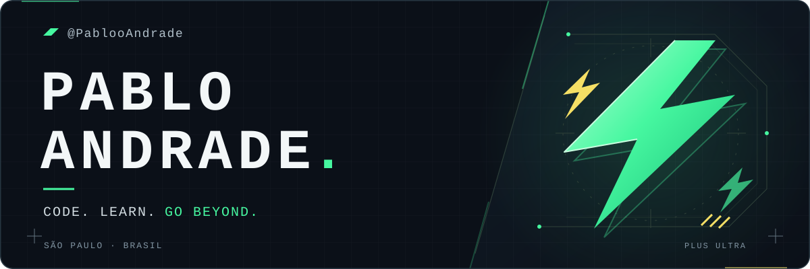
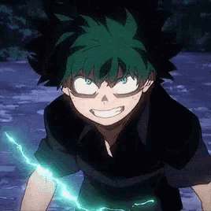

  

  <strong>Interfaces com personalidade. Sistemas com propósito. Evolução constante.</strong>

### 01 · Meu arco atual

Sou o **Pablo, de Uberlândia, MG**. Transformo ideias em aplicações web, interfaces e ferramentas que conectam pessoas, processos e dados.

Meu dia a dia passa por **TypeScript, React e Next.js**, com **Tailwind CSS** no visual. Por trás da interface, trabalho com **Node.js, Python, APIs e bancos de dados** para fazer tudo funcionar junto.

A maior parte do que construo vive em repositórios privados. Por aqui, compartilho um pouco da stack, da curiosidade e da vontade de continuar evoluindo.

  
   
  Um problema de cada vez. Um commit de cada vez.
   
  <strong>PLUS ULTRA.</strong>

---

### 02 · Meu arsenal

**Interfaces & experiência**

  

TypeScript · React · Next.js · Tailwind CSS

**Backend & dados**

  

Node.js · Python · PostgreSQL · Supabase

**Também entram na missão:** Vite, Fastify, FastAPI, Pandas e Recharts. 
**Para conferir as entregas:** Playwright e Vitest.

---

### 03 · O que gosto de construir

- **Aplicações web** — interfaces cuidadas, navegação clara e experiências com movimento.
- **Dashboards e ferramentas de dados** — transformar informação em algo que ajude a decidir.
- **APIs e integrações** — conectar serviços e dar vida à lógica por trás das telas.

> Meu próximo nível começa no próximo problema que eu decido resolver.

  
   
  Pronto para o próximo desafio.

  <code>BUILD → LEARN → IMPROVE → REPEAT</code>

  GIFs: My Hero Academia · <a href="https://tenor.com/view/deku-izuku-midoriya-my-hero-academia-green-lightning-power-gif-13935625">Deku / Tenor</a> · <a href="https://tenor.com/view/anime-thumbs-up-approve-all-might-gif-10138734">All Might / Tenor</a> · Ícones: <a href="https://github.com/tandpfun/skill-icons">Skill Icons</a>

