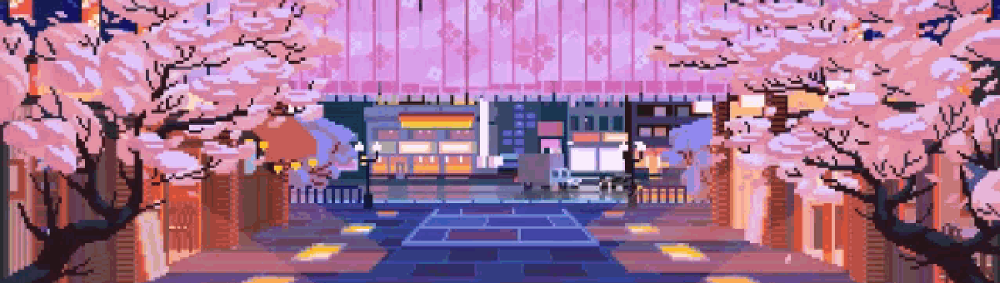

<!-- Previous yellow banner preserved in assets/hero.svg. -->

  

  <strong>Web applications, thoughtful interfaces and the systems behind them.</strong>

### 01 · About me

I'm **Pablo de Andrade**, a software developer based in **Brazil**, working on projects in Europe. I build web applications, dashboards and integrations, from the user interface through to the backend.

I work primarily with **TypeScript, React and Next.js**, with **Tailwind CSS** for styling. For backend services and data workflows, I use **Node.js, Python, PostgreSQL and Supabase**.

Most of my work is in private repositories. Here you'll find an overview of my stack and the kind of software I enjoy building.

  
   
  One problem at a time. One commit at a time.
   
  <strong>PLUS ULTRA.</strong>

---

### 02 · My stack

**Frontend & user experience**

  

TypeScript · React · Next.js · Tailwind CSS

**Backend & data**

  

Node.js · Python · PostgreSQL · Supabase

**Also in my toolkit:** Vite, Fastify, FastAPI, Pandas and Recharts. 
**Testing:** Playwright and Vitest.

---

### 03 · What I build

- **Web applications** — interfaces that are easy to navigate and pleasant to use.
- **Dashboards & data tools** — making information easier to explore, understand and act on.
- **APIs & integrations** — connecting services and supporting the workflows behind the interface.

  
   
  On to the next challenge.

  <code>BUILD → LEARN → IMPROVE → REPEAT</code>

  Banner: <a href="https://tenor.com/view/landscape-city-life-japan-pixel-gif-12746051">Tenor / cyndaye</a> · GIFs: My Hero Academia · <a href="https://tenor.com/view/deku-izuku-midoriya-my-hero-academia-green-lightning-power-gif-13935625">Deku / Tenor</a> · <a href="https://tenor.com/view/anime-thumbs-up-approve-all-might-gif-10138734">All Might / Tenor</a> · Icons: <a href="https://github.com/tandpfun/skill-icons">Skill Icons</a>

